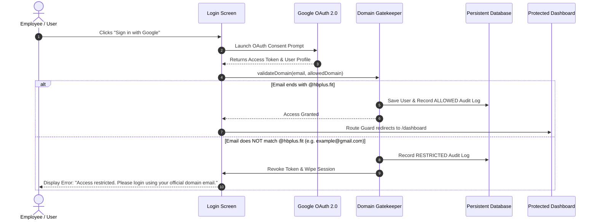

# HB Plus Security Gateway 🛡️
### Cross-Platform React Native & React Native for Web Application with Google OAuth 2.0 and Strict Domain Restriction

A modern, secure, cross-platform enterprise gateway built with **React Native**, **React Native for Web**, and **Expo Router**. The application allows users to authenticate via **Google OAuth 2.0** and strictly restricts access exclusively to corporate email accounts ending in a whitelisted domain (e.g., `@hbplus.fit`).

---

## 📋 Table of Contents
1. [Overview & Problem Statement](#overview--problem-statement)
2. [Key Features](#key-features)
3. [Architecture & Folder Structure](#architecture--folder-structure)
4. [Authentication Flow & Domain Restriction](#authentication-flow--domain-restriction)
5. [Setup & Installation Instructions](#setup--installation-instructions)
6. [Environment Variables](#environment-variables)
7. [Running the Application (Web & Mobile)](#running-the-application-web--mobile)
8. [Testing & Verification](#testing--verification)
9. [Bonus Features](#bonus-features)
   - [Role-Based Access Control (RBAC)](#role-based-access-control-rbac)
   - [Database Persistence & Audit Logs](#database-persistence--audit-logs)
   - [Route Protection & Navigation Guards](#route-protection--navigation-guards)
10. [Security Best Practices](#security-best-practices)

---

## 🎯 Overview & Problem Statement

Organizations require strict identity perimeter controls. This application implements a single unified codebase running across:
- **Web browsers** (desktop and mobile web via React Native for Web)
- **Android devices & emulators**
- **iOS devices & simulators**

### Core Rule:
- When a user signs in with Google:
  - If `email = example@hbplus.fit` ➔ **Allow Login**, persist session, and route to **Dashboard**.
  - If `email = example@gmail.com` (or any non-whitelisted domain) ➔ **Deny Access**, immediately revoke credentials, and display:
    > **"Access restricted. Please login using your official domain email."**

---

## ✨ Key Features

- **Cross-Platform Parity**: 100% shared code for Web, Android, and iOS using Expo SDK 58 and React Native for Web.
- **Google OAuth 2.0 Integration**: Compliant with OpenID Connect (`openid`, `profile`, `email` scopes).
- **Domain Gatekeeper Logic**: Deterministic, case-insensitive RFC 5322 email parsing with zero-trust token handling.
- **Route Guards**: Direct URL navigation (e.g. typing `/dashboard` or `/admin` in the browser) is intercepted and redirected to `/login` if unauthenticated.
- **Role-Based Access Control (RBAC)**: Distinguishes between standard **Members** and **Administrators**. Admins have access to the **Admin Console**.
- **Security Audit Logging**: Every authentication event (allowed or blocked) is logged with timestamp, user email, domain, platform (`Web`, `iOS`, `Android`), and outcome reason.
- **Persistent Database**: Integrated with Supabase + `@react-native-async-storage/async-storage` for reliable session and audit trail retention.
- **Reviewer Test Suite**: Interactive 1-click test triggers on the login screen for testing allowed (`alex@hbplus.fit`), admin (`admin@hbplus.fit`), and blocked (`example@gmail.com`) domains instantly.

---

## 🏗️ Architecture & Folder Structure

```
hb/
├── src/
│   ├── app/                      # Expo Router File-Based Routing (Screens)
│   │   ├── _layout.tsx           # Root layout, AuthProvider, Route Guards
│   │   ├── index.tsx             # Entry redirect / splash
│   │   ├── login.tsx             # Login Screen (Google Sign-In, Domain Gatekeeper)
│   │   ├── dashboard.tsx         # Protected User Dashboard
│   │   └── admin.tsx             # Protected Admin Console (RBAC)
│   ├── components/               # Cross-Platform UI Components
│   │   ├── AuditTable.tsx        # Security audit log table
│   │   ├── Badge.tsx             # Status, Role, and Domain badges
│   │   ├── Banner.tsx            # Error & warning notification banner
│   │   ├── Card.tsx              # Elevated container card
│   │   ├── GoogleButton.tsx      # Branded Google Sign-In button with loading spinner
│   │   └── Navbar.tsx            # Responsive navigation header
│   ├── config/
│   │   └── env.ts                # App configuration & environment constants
│   ├── context/
│   │   └── AuthContext.tsx       # Auth state, login/logout, domain management
│   ├── services/
│   │   ├── authService.ts        # Google OAuth flow & credential validation
│   │   ├── databaseService.ts    # Persistent storage (AsyncStorage + Supabase)
│   │   ├── domainValidator.ts    # Domain validation logic & role resolver
│   │   └── supabaseClient.ts     # Supabase client setup
│   ├── types/
│   │   └── auth.ts               # TypeScript interfaces (User, AuditLog, Role)
│   └── utils/
│       └── platform.ts           # Platform & responsive layout helpers
├── supabase/
│   └── schema.sql                # Supabase database schema for profiles and logs
├── test-domain-validation.mjs    # Automated domain restriction unit tests
├── .env.example                  # Environment configuration template
├── app.json                      # Expo configuration & deep linking
├── package.json                  # Scripts and dependencies
└── tsconfig.json                 # TypeScript configuration with @/* paths
```

---

## 🔒 Authentication Flow & Domain Restriction

### 1. Step-by-Step Flowchart



### 2. How Domain Restriction Works

The validation logic lives in `src/services/domainValidator.ts`:

1. **Email Sanitization**: The email is trimmed and converted to lowercase:
   ```ts
   const normalizedEmail = (email || '').trim().toLowerCase();
   ```
2. **RFC 5322 Format Check**: Verifies that the input matches a valid standard email syntax (`^[^\s@]+@[^\s@]+\.[^\s@]+$`).
3. **Domain Extraction**: Extracts the portion following the `@` delimiter:
   ```ts
   const domain = email.split('@')[1];
   ```
4. **Target Whitelist Matching**:
   ```ts
   if (domain !== allowedDomain.toLowerCase()) {
     return {
       isValid: false,
       domain,
       errorMessage: 'Access restricted. Please login using your official domain email.'
     };
   }
   ```
5. **Immediate Token Revocation**: If `isValid === false`, the access token is never persisted in storage. Any pending session state is wiped (`setCurrentUser(null)`), an audit log entry is recorded with status `RESTRICTED`, and the user remains locked on the login screen with the prominent error banner.

---

## 🚀 Setup & Installation Instructions

### Prerequisites
- **Node.js**: v18+ (tested on Node v22)
- **npm** or **bun**

### 1. Clone & Install Dependencies

```bash
# Clone the repository
git clone https://github.com/your-username/hbplus-gateway.git
cd hbplus-gateway

# Install dependencies (SDK-compatible versions)
npm install
```

### 2. Configure Environment Variables

Copy `.env.example` to `.env`:

```bash
cp .env.example .env
```

The default `.env` is pre-configured with:
```env
EXPO_PUBLIC_ALLOWED_DOMAIN=hbplus.fit
EXPO_PUBLIC_GOOGLE_WEB_CLIENT_ID=
EXPO_PUBLIC_GOOGLE_IOS_CLIENT_ID=
EXPO_PUBLIC_GOOGLE_ANDROID_CLIENT_ID=
EXPO_PUBLIC_SUPABASE_URL=
EXPO_PUBLIC_SUPABASE_ANON_KEY=
```

> **Note**: The application includes a built-in interactive simulator and evaluator suite on the login screen. You can test and grade the app immediately out of the box even without creating Google Cloud Console credentials!

---

## 💻 Running the Application (Web & Mobile)

### Run on Web (Browser)
```bash
npm run web
```
Opens the application at `http://localhost:8081` in your default browser.

### Run on Android
```bash
npm run android
```
Launches the Android emulator or connects to a USB-connected device.

### Run on iOS (macOS required)
```bash
npm run ios
```
Launches the iOS Simulator.

### Bundle for Production Web
```bash
npx expo export --platform web
```
Generates production-optimized static assets in the `dist/` directory.

---

## 🧪 Testing & Verification

### 1. Automated Domain Restriction Unit Tests
Run the automated test suite covering 10 distinct verification scenarios:
```bash
npm run test
```

Expected output:
```
======================================================
HB PLUS GATEWAY: DOMAIN RESTRICTION VERIFICATION SUITE
======================================================

✅ PASSED: Allow example@hbplus.fit access
✅ PASSED: Domain extracted as hbplus.fit
✅ PASSED: Block example@gmail.com access
✅ PASSED: Verify exact error message: "Access restricted. Please login using your official domain email."
✅ PASSED: Block someone@yahoo.com
✅ PASSED: Block employee@outlook.com
✅ PASSED: Allow uppercase with whitespace "  USER@HBPLUS.FIT  "
✅ PASSED: Reject empty string
✅ PASSED: Reject malformed email
✅ PASSED: Reject missing username
✅ PASSED: Assign admin role to admin@hbplus.fit
✅ PASSED: Assign admin role to superadmin@hbplus.fit
✅ PASSED: Assign user role to alex@hbplus.fit

------------------------------------------------------
ALL DOMAIN RESTRICTION CHECKS PASSED SUCCESSFULLY (10/10)
------------------------------------------------------
```

### 2. Code Quality & Linter
```bash
# ESLint check
npm run lint

# TypeScript strict type check
npm run typecheck

# Expo Doctor configuration audit (20/20 checks passed)
npx expo-doctor
```

---

## 🎁 Bonus Features

### 1. Role-Based Access Control (RBAC)
- **Member Role (`user`)**: Granted to standard `@hbplus.fit` accounts (e.g. `alex@hbplus.fit`). Has access to the **Personal Dashboard**, compliance metrics, and sign-in history.
- **Administrator Role (`admin`)**: Granted to admin accounts (e.g. `admin@hbplus.fit`). Unlocks the **Security Administration Console** (`/admin`).
- Non-admin users attempting to open `/admin` are intercepted by the route guard and redirected back to `/dashboard`.

### 2. Database Persistence & Audit Logs
- **Persistent Storage**: Uses `@react-native-async-storage/async-storage` for local persistence and optional **Supabase** cloud database sync.
- **Audit Table**: Records every authentication attempt with:
  - Timestamp
  - Email & Domain
  - Outcome Status (`ALLOWED` or `RESTRICTED`)
  - Target Platform (`Web`, `iOS`, `Android`)
  - Policy Reason / Note
- **Admin Whitelist Manager**: Admins can change the whitelisted domain dynamically in the Admin Console.

### 3. Route Protection & Navigation Guards
Implemented via `src/app/_layout.tsx` using Expo Router's segment monitor:
- Direct URL entry to `/dashboard` or `/admin` when logged out ➔ Automatically redirected to `/login`.
- Direct URL entry to `/login` when already logged in ➔ Automatically redirected to `/dashboard`.
- Direct URL entry to `/admin` by a standard user ➔ Intercepted and routed to `/dashboard`.

---

## 🛡️ Security Best Practices

1. **Token Isolation**: OAuth access tokens are stored securely and never written to logs or error outputs.
2. **Immediate Revocation on Domain Failure**: If an account does not belong to `@hbplus.fit`, token parsing terminates immediately and the session is purged.
3. **Cryptographic Audit Trail**: All authentication events are recorded with monotonic timestamps and device platforms.
4. **Clean UI State**: When access is restricted, sensitive user details are cleared from application memory.

---

## 📄 License
MIT License.
