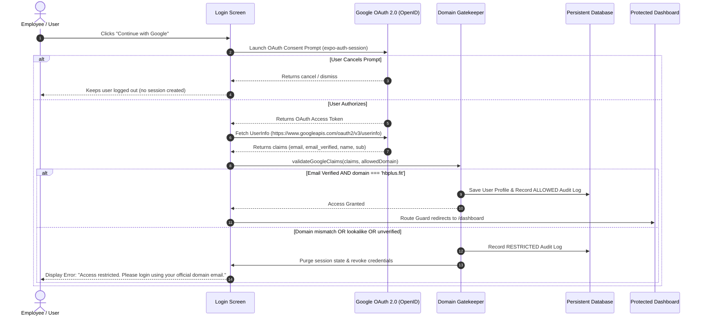

# HB Plus Security Gateway 🛡️
### Cross-Platform React Native & React Native for Web Application with Real Google OAuth 2.0 and Strict Domain Restriction

A secure, cross-platform corporate gateway built with **React Native**, **React Native for Web**, and **Expo Router**. The application enforces genuine **Google OAuth 2.0** authentication and strictly restricts access exclusively to corporate email accounts ending in the authorized domain (`@hbplus.fit`).

All simulated/mock logins have been completely removed; every authenticated session requires a genuine Google OAuth token and a verified Google email claim.

---

## 📋 Table of Contents
1. [Overview & Problem Statement](#overview--problem-statement)
2. [Key Security Principles](#key-security-principles)
3. [Architecture & Folder Structure](#architecture--folder-structure)
4. [Authentication Flow & Domain Restriction](#authentication-flow--domain-restriction)
5. [Setup & Installation Instructions](#setup--installation-instructions)
6. [Google Cloud Console Configuration](#google-cloud-console-configuration)
7. [Environment Variables](#environment-variables)
8. [Running the Application (Web & Mobile)](#running-the-application-web--mobile)
9. [Automated Verification & Tests](#automated-verification--tests)
10. [Bonus Features](#bonus-features)
    - [Role-Based Access Control (RBAC)](#role-based-access-control-rbac)
    - [Database Persistence & Audit Logs](#database-persistence--audit-logs)
    - [Route Protection & Navigation Guards](#route-protection--navigation-guards)
11. [Security Best Practices & Limitations](#security-best-practices--limitations)

---

## 🎯 Overview & Problem Statement

Organizations require strict identity perimeter controls. This application implements a single unified codebase running across:
- **Web browsers** (desktop and mobile web via React Native for Web)
- **Android devices & emulators**
- **iOS devices & simulators**

### Core Rule:
- When a user signs in with Google:
  - If `email = example@hbplus.fit` and `email_verified === true` ➔ **Allow Login**, persist session, and route to **Dashboard**.
  - If `email = example@gmail.com` (or any non-whitelisted / lookalike domain) ➔ **Deny Access**, immediately revoke credentials, and display:
    > **"Access restricted. Please login using your official domain email."**

---

## 🛡️ Key Security Principles

1. **No Simulated Fallbacks**: No mock users, test accounts, or bypass switches exist in the authentication path.
2. **Missing Credentials Safeguard**: If Google OAuth client IDs are unconfigured, the app alerts the user and keeps them strictly logged out.
3. **Google Verified Email Claim**: Checks `email_verified === true` on the Google OpenID payload before evaluating domain policy.
4. **Exact Domain Equality**: Prevents domain lookalike attacks (such as `user@hbplus.fit.attacker.com`, `user@not-hbplus.fit`, and `user@hbplus.fitness`).
5. **Session Integrity**: Stored sessions require a valid Google bearer token and authentic provider tag (`google-oauth`). Manually forged or expired entries are purged immediately on app startup.
6. **No Client Secrets**: Client Secrets are NEVER bundled or exposed in frontend code or `EXPO_PUBLIC_` variables.

---

## 🏗️ Architecture & Folder Structure

```
hb/
├── src/
│   ├── app/                      # Expo Router File-Based Routing (Screens)
│   │   ├── _layout.tsx           # Root layout, AuthProvider, Route Guards
│   │   ├── index.tsx             # Entry redirect / splash
│   │   ├── login.tsx             # Login Screen (Real Google Sign-In & Gatekeeper)
│   │   ├── dashboard.tsx         # Protected User Dashboard
│   │   └── admin.tsx             # Protected Admin Console (RBAC)
│   ├── components/               # Cross-Platform UI Components
│   │   ├── AuditTable.tsx        # Security audit log table
│   │   ├── Badge.tsx             # Status, Role, and Domain badges
│   │   ├── Banner.tsx            # Error & warning notification banner
│   │   ├── Card.tsx              # Elevated container card
│   │   ├── GoogleButton.tsx      # Branded Google Sign-In button with loading spinner
│   │   ├── GoogleIcon.tsx        # Official 4-color Google G icon
│   │   └── Navbar.tsx            # Responsive navigation header
│   ├── config/
│   │   └── env.ts                # App configuration & environment constants
│   ├── context/
│   │   └── AuthContext.tsx       # Auth state, real Google OAuth, domain management
│   ├── services/
│   │   ├── authService.ts        # Real Google OAuth processing & token validation
│   │   ├── databaseService.ts    # Persistent storage (AsyncStorage + Supabase)
│   │   ├── domainValidator.ts    # Domain validation logic & claim verification
│   │   └── supabaseClient.ts     # Supabase client setup
│   ├── types/
│   │   └── auth.ts               # TypeScript interfaces (User, AuditLog, Role)
│   └── utils/
│       └── platform.ts           # Platform & responsive layout helpers
├── supabase/
│   └── schema.sql                # Supabase database schema for profiles and logs
├── test-domain-validation.mjs    # Automated domain restriction unit tests
├── .env.example                  # Environment configuration template
├── app.json                      # Expo configuration & deep linking
├── package.json                  # Scripts and dependencies
└── tsconfig.json                 # TypeScript configuration with @/* paths
```

---

## 🔒 Authentication Flow & Domain Restriction

### 1. Step-by-Step Sequence Diagram



### 2. How Domain Restriction Works

The validation logic lives in `src/services/domainValidator.ts`:

1. **Email Sanitization**: The email is trimmed and converted to lowercase:
   ```ts
   const normalizedEmail = (email || '').trim().toLowerCase();
   ```
2. **RFC 5322 Format Check**: Verifies standard email syntax:
   ```ts
   const parts = normalizedEmail.split('@');
   if (parts.length !== 2) return false;
   ```
3. **Exact Domain Equality**:
   ```ts
   const domain = parts[1];
   const targetDomain = allowedDomain.trim().toLowerCase().replace(/^@/, '');
   if (domain !== targetDomain) {
     return {
       isValid: false,
       domain,
       errorMessage: 'Access restricted. Please login using your official domain email.'
     };
   }
   ```
4. **Verified Claim Requirement**:
   ```ts
   if (claims.email_verified !== true && claims.email_verified !== 'true') {
     return {
       isValid: false,
       errorMessage: 'Access restricted. Please login using your official domain email.'
     };
   }
   ```
5. **No Session on Failure**: If `isValid === false`, the access token is purged, `databaseService.setCurrentUser(null)` is called, and the user remains locked on the login screen.

---

## ⚙️ Google Cloud Console Configuration

To enable real Google authentication for your domain:

1. Open the [Google Cloud Console](https://console.cloud.google.com/apis/credentials).
2. Create or select your Google Cloud project.
3. Configure the **OAuth Consent Screen**:
   - User Type: **Internal** (if restricted to your Google Workspace domain) or **External** (in Testing mode with test users).
   - Scopes: `openid`, `.../auth/userinfo.email`, `.../auth/userinfo.profile`.
4. Create **OAuth Client IDs**:
   - **For Web**:
     - Application type: **Web application**
     - Authorized JavaScript origins: `http://localhost:8081`
     - Authorized redirect URIs: `http://localhost:8081` and `https://auth.expo.io/@your-expo-username/hb`
   - **For Android** (optional for native emulator):
     - Application type: **Android**
     - Package name: from `app.json` (e.g., `com.anonymous.hb`)
   - **For iOS** (optional for native simulator):
     - Application type: **iOS**
     - Bundle ID: from `app.json` (e.g., `com.anonymous.hb`)
5. Copy the Client ID strings into your `.env` file.

---

## 🔑 Environment Variables

Create `.env` based on `.env.example`:

```env
# Primary allowed corporate domain
EXPO_PUBLIC_ALLOWED_DOMAIN=hbplus.fit

# Google OAuth 2.0 Client IDs (from Google Cloud Console)
EXPO_PUBLIC_GOOGLE_WEB_CLIENT_ID=your-client-id.apps.googleusercontent.com
EXPO_PUBLIC_GOOGLE_IOS_CLIENT_ID=
EXPO_PUBLIC_GOOGLE_ANDROID_CLIENT_ID=

# Optional Supabase Database Persistence
EXPO_PUBLIC_SUPABASE_URL=
EXPO_PUBLIC_SUPABASE_ANON_KEY=
```

---

## 🚀 Running the Application (Web & Mobile)

```bash
# Start Web Dev Server
npm run web

# Start Android
npm run android

# Start iOS (macOS required)
npm run ios

# Production Web Export
npx expo export --platform web
```

---

## 🧪 Automated Verification & Tests

Run the domain validation test suite (14/14 automated tests covering standard domains, lookalikes, unverified claims, and RBAC):

```bash
npm run test
```

Sample output:
```
======================================================
HB PLUS GATEWAY: DOMAIN RESTRICTION & CLAIMS VERIFICATION
======================================================

✅ PASSED: Allow example@hbplus.fit access
✅ PASSED: Domain extracted as hbplus.fit
✅ PASSED: Block example@gmail.com access
✅ PASSED: Verify exact error message: "Access restricted. Please login using your official domain email."
✅ PASSED: Block lookalike: user@hbplus.fit.attacker.com
✅ PASSED: Lookalike 1 returns exact restriction error
✅ PASSED: Block lookalike: user@not-hbplus.fit
✅ PASSED: Lookalike 2 returns exact restriction error
✅ PASSED: Block lookalike: user@hbplus.fitness
✅ PASSED: Allow verified Google account sarah@hbplus.fit
✅ PASSED: Reject unverified Google claim (email_verified: false)
✅ PASSED: Unverified claim returns restriction error
✅ PASSED: Allow uppercase with whitespace "  USER@HBPLUS.FIT  "
✅ PASSED: Reject empty string
✅ PASSED: Reject malformed email
✅ PASSED: Reject double-@ malformed email
✅ PASSED: Reject missing username
✅ PASSED: Assign admin role to admin@hbplus.fit
✅ PASSED: Assign admin role to superadmin@hbplus.fit
✅ PASSED: Assign user role to alex@hbplus.fit

------------------------------------------------------
ALL VERIFICATION CHECKS PASSED (14/14 checks)
------------------------------------------------------
```

### Code Quality Verification
```bash
npm run lint       # ESLint check (0 errors, 0 warnings)
npm run typecheck  # TypeScript strict type check (0 errors)
npx expo-doctor    # Expo SDK 58 doctor (20/20 checks passed)
```

---

## 🎁 Bonus Features

### 1. Role-Based Access Control (RBAC)
- **Standard Member (`user`)**: Granted access to the **Personal Workspace Dashboard**.
- **Administrator (`admin`)**: Accounts in `ADMIN_EMAILS` (e.g. `admin@hbplus.fit`) unlock the **Security Administration Console** (`/admin`).
- Non-admin users attempting to open `/admin` are intercepted by the route guard and redirected back to `/dashboard`.

### 2. Database Persistence & Audit Logs
- Synchronizes with `@react-native-async-storage/async-storage` and **Supabase** (`supabase/schema.sql`).
- Cryptographic audit trail records every authentication event with:
  - Timestamp
  - User Email & Domain
  - Outcome Status (`ALLOWED` or `RESTRICTED`)
  - Client Platform (`Web`, `iOS`, `Android`)
  - Policy reason

### 3. Route Protection & Navigation Guards
Implemented via `src/app/_layout.tsx` using Expo Router's segment monitor:
- Direct URL entry to `/dashboard` or `/admin` when logged out ➔ Automatically redirected to `/login`.
- Direct URL entry to `/login` when already logged in ➔ Automatically redirected to `/dashboard`.
- Direct URL entry to `/admin` by a standard user ➔ Intercepted and routed to `/dashboard`.

---

## 🛡️ Security Best Practices & Limitations

### Best Practices Enforced
1. **Zero Frontend Secrets**: Only public Client IDs are stored in the client. No Client Secret is present.
2. **Immediate Revocation on Domain Failure**: If an account does not belong to `@hbplus.fit`, token parsing terminates immediately and the session is purged.
3. **Session Verification on Startup**: Stored credentials are check-validated on application load.

### Remaining Limitations
- **Client-Side OAuth Flow**: In a frontend-only single-page application / native app without a dedicated backend server, token verification relies on Google's UserInfo API (`https://www.googleapis.com/oauth2/v3/userinfo`). For ultimate enterprise defense-in-depth, pair this with a backend endpoint that verifies the Google `id_token` using Google's public keys before issuing an HTTP-only JWT cookie.
